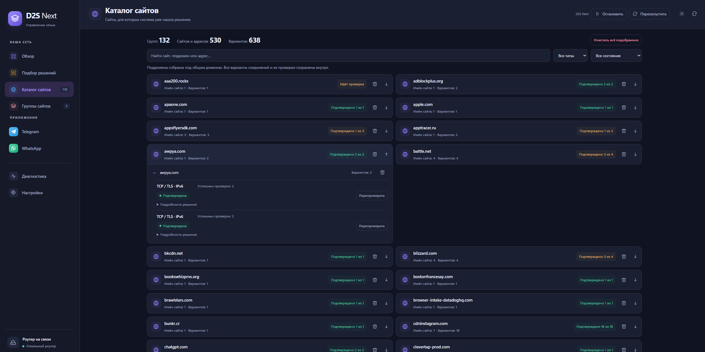
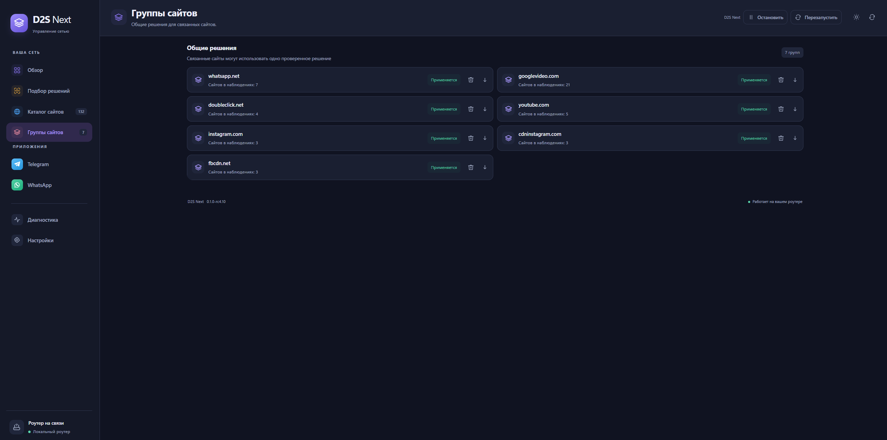
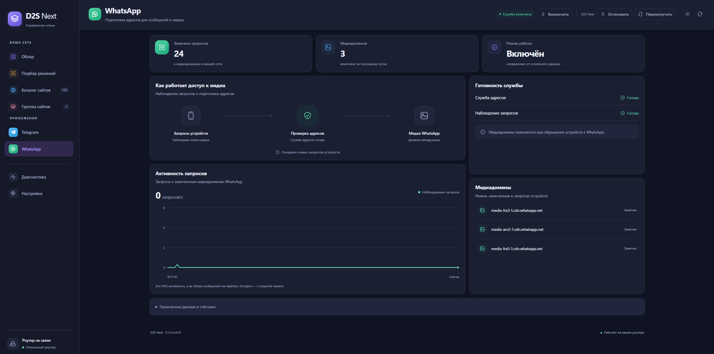
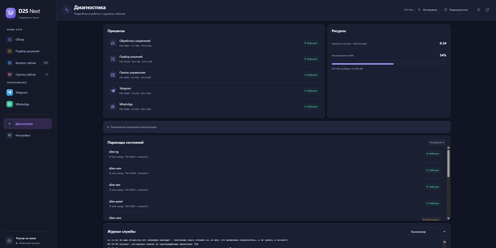

# D2S Next

D2S Next работает на роутере и автоматически подбирает решения для затруднённых соединений. Система наблюдает трафик, проверяет причины сбоев, испытывает варианты и сохраняет подтверждённые решения. Готовые списки заблокированных сайтов не требуются.

## Возможности

- Автоматический подбор для TCP/TLS и QUIC, поддержка IPv4 и IPv6.
- Каталог найденных решений и группы связанных сайтов. Сайт или группу можно удалить вместе с правилами; при новом обращении подбор начнётся заново.
- Telegram: локальный MTProto-прокси с подключением по ссылке, выбор маршрута, статистика соединений и передачи данных.
- WhatsApp: наблюдение медиадоменов и подготовка DNS-адресов для сообщений и медиа.
- Веб-панель со статусом движка, текущими поисками, графиками активности, расходом CPU и RAM роутера и D2S Next.
- Остановка и перезапуск служб, локальное и онлайн-обновление, откат, очистка найденных решений с подтверждением.
- Журналы и диагностический архив для анализа удалённого роутера.

Получение ответа на рукопожатие, восстановление транспорта и доступность приложения учитываются раздельно. Результат зависит от провайдера, прошивки и конкретного сервиса. Проект находится на стадии тестовых RC-выпусков.

В репозитории размещены установщик, описание и скриншоты. Готовые пакеты и автономный установщик — в [Releases](https://github.com/shurshick/D2S_Next/releases/latest). Изменения отдельных версий описаны на страницах релизов. Исходники приложения здесь не публикуются; лицензии и сведения о сторонних компонентах входят в пакеты (`NOTICE.md`, `LICENSE-*.txt`).

## Скриншоты

Пример интерфейса в тёмной теме. Показатели относятся к тестовому роутеру; внешний вид отдельных разделов может отличаться от текущей версии.


<details>
<summary>Все разделы панели</summary>

### Подбор решений


### Каталог сайтов



### Группы сайтов



### Telegram


### WhatsApp



### Диагностика



### Настройки


</details>

## Одна команда для Keenetic и OpenWrt

```sh
(f=$(mktemp) && curl -fLsS https://raw.githubusercontent.com/shurshick/D2S_Next/main/install.sh -o "$f" && sh "$f"; r=$?; [ -z "${f:-}" ] || rm -f "$f"; exit "$r")
```

Запускайте от root по SSH. Установщик определяет архитектуру, скачивает соответствующий пакет по HTTPS, сверяет закреплённый SHA-256 и внутренний манифест. При существующей установке выполняется штатное обновление с сохранением настроек и найденных решений. Сторонние обходчики и старый D2S автоматически не удаляются.

## Keenetic

Нужны Entware, смонтированный `/opt`, компонент KeeneticOS «Модули ядра подсистемы Netfilter», SSH Entware (обычно порт 222), curl с доверенными CA, iptables, ipset и поддержка NFQUEUE. Командная строка KeeneticOS на порту 22 не подходит. Перед установкой подготовьте Entware и пакеты:

```sh
opkg update && opkg install curl ca-bundle iptables ipset
```

Наличие модуля NFQUEUE зависит от установленных компонентов и версии KeeneticOS.

## OpenWrt

Entware не требуется. Нужны постоянное хранилище с `/opt`, root SSH, curl и CA, iptables, ipset, модули NFQUEUE/xt_NFQUEUE, совместимые с текущим ядром. В системе с `opkg` обычно нужны `curl ca-bundle iptables ipset kmod-nfnetlink-queue kmod-ipt-nfqueue`; для прошивок с `apk` используйте их пакетный менеджер. Не устанавливайте модули от чужой версии ядра. Смешение правил fw4/nftables и iptables зависит от прошивки — универсальная совместимость всех образов не заявляется.

Подготовьте `/opt` на постоянном разделе, при необходимости на USB. Не размещайте установленную программу в `/tmp`: она исчезнет после перезагрузки. Требуется минимум 22 МиБ свободного места в `/opt`, дополнительная RAM для скачивания, распаковки, служб и диагностики. Роутеры с малым объёмом RAM требуют отдельной проверки.

## Поддерживаемые архитектуры

| Архитектура | Пакет |
| --- | --- |
| ARM64 | `d2s-next-arm64.tar.gz` |
| ARMv7 | `d2s-next-armv7.tar.gz` |
| MIPS little-endian, 32-bit soft-float | `d2s-next-mipsel.tar.gz` |
| MIPS big-endian, 32-bit soft-float | `d2s-next-mips.tar.gz` |
| x86_64 | `d2s-next-x86_64.tar.gz` |

Поставляются статические Linux-сборки. MIPS64 и другие ABI не включены. Сборка под нужную архитектуру не заменяет проверку поддержки NFQUEUE ядром конкретного роутера. Пакеты проверяются под QEMU; установка, обновление и откат — также в изолированной Linux-среде. Это не гарантия совместимости со всеми моделями и прошивками.

## Панель управления

После установки откройте адрес, напечатанный установщиком: `http://LAN_IP_РОУТЕРА:8090`. Панель предназначена для локальной сети. Для удалённого доступа используйте защищённую сеть или туннель, не открывайте порт панели в интернет.

В разделе **Telegram → Подключить Telegram** доступна ссылка для приложения. Секрет локального MTProto-прокси создаётся на роутере и сохраняется при штатном обновлении.

Управление службами доступно в панели. Скрипт автозапуска OpenWrt — `/etc/init.d/d2sn`, Keenetic — `/opt/etc/init.d/S95d2sn`.

Перед установкой остановите конфликтующие DPI-обходчики и удалите прежний D2S штатным способом. Чужие программы и их настройки установщик автоматически не удаляет.

## Онлайн-обновление одной командой

```sh
(f=$(mktemp) && curl -fLsS https://raw.githubusercontent.com/shurshick/D2S_Next/main/install.sh -o "$f" && sh "$f" --update; r=$?; [ -z "${f:-}" ] || rm -f "$f"; exit "$r")
```

Сохраняет настройки, MTProto-секрет и найденные решения. Повторный запуск для уже установленной версии ничего не меняет.

## Полное онлайн-удаление одной командой

```sh
(f=$(mktemp) && curl -fLsS https://raw.githubusercontent.com/shurshick/D2S_Next/0b71154/install.sh -o "$f" && sh "$f" --uninstall; r=$?; [ -z "${f:-}" ] || rm -f "$f"; exit "$r")
```

Выполняйте от root на нужном роутере. Команда скачивает только управляющий скрипт и вызывает штатное полное удаление установленного D2S Next. Пакеты приложения не скачиваются. Удаляются программа, автозапуск, собственные сетевые правила, найденные решения, журналы, настройки и MTProto-секрет. Чужие программы не удаляются. Операция необратима. При отсутствии D2S Next команда завершается без изменений; при повреждённой установке отказывается удалять каталог вслепую.

Без интернета можно вызвать установленный менеджер напрямую:

```sh
sh /opt/d2s-next/current/libexec/manage.sh uninstall
```

## Автономная установка и локальное обновление

Скачайте ZIP-комплект из [последнего релиза](https://github.com/shurshick/D2S_Next/releases/latest), распакуйте его целиком и следуйте инструкции внутри. Комплект содержит готовые пакеты для пяти архитектур, контрольные суммы и установщик с автоматическим выбором пакета.

Для обновления через панель откройте **Настройки → Обновление, откат и выгрузка диагностики**, выберите пакет своей архитектуры и нажмите **Загрузить и обновить**. Там же можно вернуть предыдущую версию. Штатное обновление сохраняет настройки, MTProto-секрет и найденные решения; очищать каталог перед ним не требуется.

## Диагностический архив

Откройте **Настройки → Обновление, откат и выгрузка диагностики → Скачать архив**. Браузер сохранит `.tar.gz`, либо `.tar`, если сжатие недоступно.

В архив входят состояние, события, журналы служб, статистика Telegram и готовый отчёт, если сбор диагностики был включён. Недоступные данные отмечаются в `collection.txt`. История задним числом не восстанавливается. Секрет прокси не запрашивается; архив может содержать IP-адреса и домены.

## DNS

Встроенная DNS-служба поставляется вместе с D2S Next. SmartDNS Manager для работы не требуется. Системное разрешение имён использует DNS роутера из `/etc/resolv.conf`; если роутер направляет запросы в локальный SmartDNS, используется этот путь.

Для фиксированного набора медиадоменов дополнительно запрашиваются публичные DNS `1.1.1.1`, `8.8.8.8` и `9.9.9.9`, ответы объединяются с системными. Это не режим использования исключительно DNS роутера.
