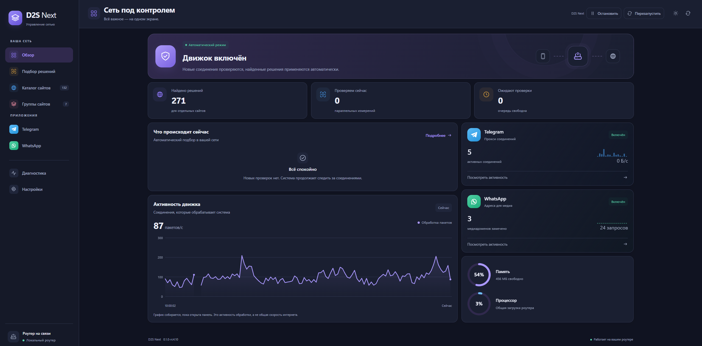
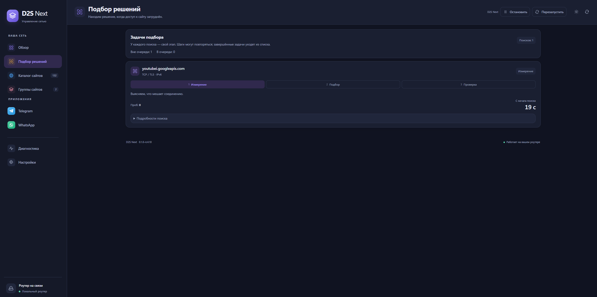
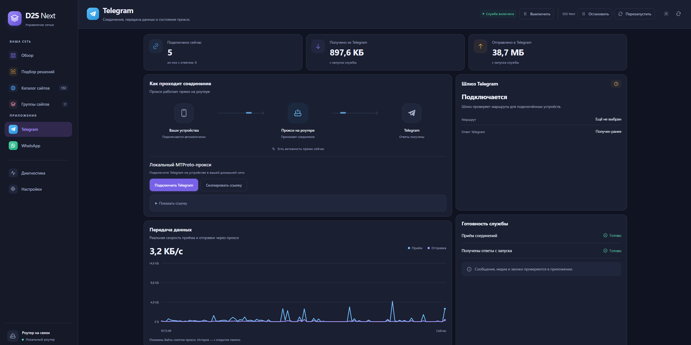
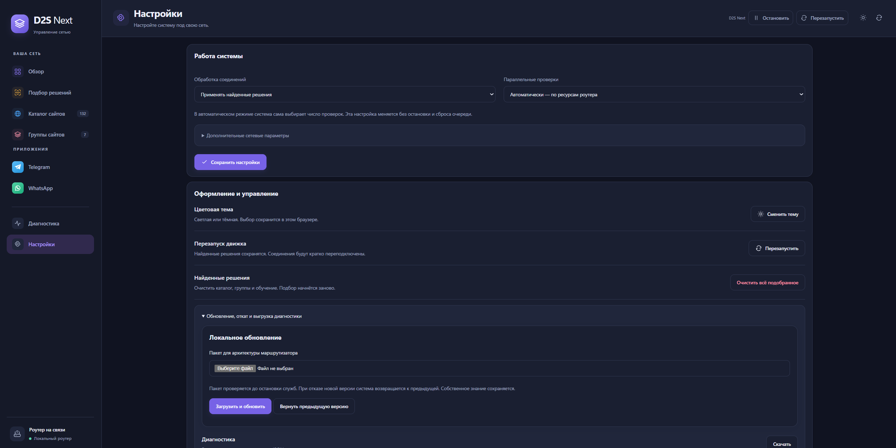

# D2S Next

Автоматический подбор решений для затруднённых соединений на роутере. Система наблюдает трафик, проверяет варианты и сохраняет рабочие решения. Готовые списки заблокированных сайтов не требуются.

Тестовый выпуск **0.1.0-rc4.17**. Панель управления, TCP/TLS, QUIC, IPv4/IPv6, Telegram с локальным MTProto-прокси и маршрутизацией, подготовка DNS-адресов WhatsApp. Результат зависит от сети и прошивки. Это RC для тестирования.

В репозитории — установщик и описание; готовые пакеты — в Releases. Исходники приложения здесь не публикуются. Лицензии и сведения о сторонних компонентах находятся внутри пакетов, в NOTICE.md и LICENSE-*.txt.

## Скриншоты

Интерфейс D2S Next rc4.10, тёмная тема. Показатели на снимках относятся к тестовому роутеру.



<details>
<summary>Все разделы панели</summary>

### Подбор решений



### Каталог сайтов


### Группы сайтов


### Telegram



### WhatsApp


### Диагностика


### Настройки



</details>

## Одна команда для Keenetic и OpenWrt

```sh
(f=$(mktemp) && curl -fLsS https://raw.githubusercontent.com/shurshick/D2S_Next/main/install.sh -o "$f" && sh "$f"; r=$?; [ -z "${f:-}" ] || rm -f "$f"; exit "$r")
```

Запускайте от root по SSH. Установщик определяет архитектуру, скачивает соответствующий пакет по HTTPS, сверяет закреплённый SHA-256 и внутренний манифест. При существующей установке выполняется штатное обновление с сохранением настроек и найденных решений. Сторонние обходчики и старый D2S автоматически не удаляются.

## Keenetic

Нужны Entware, смонтированный `/opt`, компонент KeeneticOS «Модули ядра подсистемы Netfilter», SSH Entware (обычно порт 222), curl с доверенными CA, iptables, ipset и поддержка NFQUEUE. Командная строка KeeneticOS на порту 22 не подходит. Перед установкой подготовьте Entware и пакеты:

```sh
opkg update && opkg install curl ca-bundle iptables ipset
```

Наличие модуля NFQUEUE зависит от установленных компонентов и версии KeeneticOS.

## OpenWrt

Entware не требуется. Нужны постоянное хранилище с `/opt`, root SSH, curl и CA, iptables, ipset, модули NFQUEUE/xt_NFQUEUE, совместимые с текущим ядром. В системе с `opkg` обычно нужны `curl ca-bundle iptables ipset kmod-nfnetlink-queue kmod-ipt-nfqueue`; для прошивок с `apk` используйте их пакетный менеджер. Не устанавливайте модули от чужой версии ядра. Смешение правил fw4/nftables и iptables зависит от прошивки — универсальная совместимость всех образов не заявляется.

Подготовьте `/opt` на постоянном разделе, при необходимости на USB. Не размещайте установленную программу в `/tmp`: она исчезнет после перезагрузки. Требуется минимум 22 МиБ свободного места в `/opt`, дополнительная RAM для скачивания, распаковки, служб и диагностики. Роутеры с малым объёмом RAM требуют отдельной проверки.

## Архитектуры и проверка

ARM64, ARMv7, MIPS little-endian и big-endian (32-bit soft-float), x86_64; статические Linux-сборки. MIPS64 и произвольные другие ABI не включены. MIPS big-endian проверен под QEMU; физический роутер этой архитектуры не проверялся. Все пакеты проверены под QEMU; установка, обновление и откат — в изолированной Linux-среде. Предыдущая rc4.10 установлена и проверена на основном Keenetic; rc4.17 проверена в изолированной среде. Физическая проверка rc4.17 на роутерах пока не проведена.

## Панель и управление

После установки откройте адрес, напечатанный установщиком: `http://LAN_IP_РОУТЕРА:8090`. Панель доступна в LAN; не публикуйте её в интернете. Telegram → «Подключить Telegram» выдаёт ссылку локального MTProto-прокси. Секрет создаётся на роутере и не поставляется в пакетах.

В панели доступны состояние, подбор, каталог, группы, Telegram, WhatsApp, диагностика, остановка и перезапуск. Для OpenWrt также используется `/etc/init.d/d2sn`, для Keenetic — `/opt/etc/init.d/S95d2sn`.

Обновление: повторите одну команду выше либо загрузите подходящий пакет через панель. Для офлайн-установки скачайте ZIP из Releases, распакуйте целиком и прочитайте инструкцию внутри.

Перед установкой остановите конфликтующие DPI-обходчики и удалите прежний D2S штатным способом. Установщик не должен стирать чужие настройки.

## Онлайн-обновление одной командой

```sh
(f=$(mktemp) && curl -fLsS https://raw.githubusercontent.com/shurshick/D2S_Next/main/install.sh -o "$f" && sh "$f" --update; r=$?; [ -z "${f:-}" ] || rm -f "$f"; exit "$r")
```

Сохраняет настройки, MTProto-секрет и найденные решения. Повторный запуск для уже установленной версии ничего не меняет.

## Полное онлайн-удаление одной командой

```sh
(f=$(mktemp) && curl -fLsS https://raw.githubusercontent.com/shurshick/D2S_Next/0b71154/install.sh -o "$f" && sh "$f" --uninstall; r=$?; [ -z "${f:-}" ] || rm -f "$f"; exit "$r")
```

Выполняйте от root на нужном роутере. Команда скачивает только управляющий скрипт и вызывает штатное полное удаление установленного D2S Next. Пакеты приложения не скачиваются. Удаляются программа, автозапуск, собственные сетевые правила, найденные решения, журналы, настройки и MTProto-секрет. Чужие программы не удаляются. Операция необратима. При отсутствии D2S Next команда завершается без изменений; при повреждённой установке отказывается удалять каталог вслепую.

Без интернета можно вызвать установленный менеджер напрямую:

```sh
sh /opt/d2s-next/current/libexec/manage.sh uninstall
```

## Архив для удалённого анализа

После обновления: **Диагностика → Скачать диагностический архив** или **Настройки → Обновление, откат и выгрузка диагностики → Скачать архив**. Браузер скачает `.tar.gz` (либо `.tar`, если браузер не поддерживает gzip): состояние, события, журналы служб, статистику Telegram и готовый отчёт диагностики, если сбор был включён. Недоступные данные отмечены в `collection.txt`. Выгрузка не включает сбор истории задним числом. Секрет прокси не запрашивается; архив может содержать IP-адреса и домены. Подключение браузера к панели удалённого роутера должно уже работать через вашу защищённую сеть/туннель; открывать панель в интернет не требуется.

В rc4.11 исправлена очистка всего найденного на прошивках с целочисленным `sleep`. После обновления повторите очистку и подтвердите её. Строка `D2S Next DNS: local resolver listening on 127.0.0.1:9083` относится к встроенному `d2sn-dns`: отдельный d2o/сервис регистрации для него не требуется.

SmartDNS Manager не требуется. Системное разрешение имён использует DNS роутера из `/etc/resolv.conf`; если роутер направляет их в локальный SmartDNS, используется этот путь. Для фиксированного набора медиадоменов дополнительно запрашиваются публичные DNS 1.1.1.1, 8.8.8.8 и 9.9.9.9, ответы объединяются с системными. Это не режим использования исключительно DNS роутера. Работа без SmartDNS проверена в отдельной сети с контролируемым DNS из resolv.conf.

## Исправление картинок на CDN — rc4.12

Убрана преждевременная остановка поиска на полном HTTP 400/404. План сохраняется с пометкой **«TLS подтверждён»** только после проверки точного применения и двух сопоставимых соединений без стратегии, на которых TLS не прошёл. Сертификат должен совпадать; неполные ответы, ошибки измерителя, блок-страницы, реальный ECH и измеренные обрывы данных этим результатом не маскируются. HTTP 400/404 не становится успехом приложения.

Это устраняет обнаруженную в архиве остановку подбора для i.ytimg.com и yt3.ggpht.com. После обновления повторно откройте YouTube и обновите страницу. Очищать каталог не требуется. Автотесты и пакеты проверены; загрузку картинок на конкретном удалённом устройстве нужно подтвердить после обновления. DNS и медиадомены не менялись.

## Подбор и достоверность измерений — rc4.13

Исправлен подбор при неоднозначных результатах сетевых измерений.

- Молчание на повторный HTTP/HTTP3-запрос больше не считается доказанным обрывом DPI и не отбрасывает кандидата само по себе.
- Классификация ограничена 90 секундами, поиск — суммарно 180 секундами. Срок не сбрасывается между фазами. Отмена кооперативная: текущий сетевой вызов может завершиться позже.
- Незавершённое измерение не создаёт отрицательного обучения, нового запрета QUIC или десятиминутной задержки повторного поиска.
- Панель отдельно показывает рукопожатие и ответ на повтор приветствия; это не подтверждение работы приложения.

Сохранены подтверждённые планы, исключения, MTProto, DNS медиадоменов и управление сетевыми правилами. Очистка каталога не требуется.

Пакеты: ARM64, ARMv7, MIPSel, MIPS big-endian и x86_64. Автономный установщик — ZIP. Исходный код приложения не публикуется.

Проверки: 102 нативных теста новой политики, большой тест планировщика с прежней политикой сроков, отдельная проверка остановки потока; ASan/UBSan; версии, SHA-256, целевой распаковщик и регрессии пяти архитектур через QEMU; установка, обновление, откат и удаление в изолированной Linux-среде. На роутеры эта версия ещё не установлена; восстановление сайтов не подтверждено.

## Перенаправления и Telegram — rc4.14

Исправлен подбор на HTTPS-перенаправлениях и перенесены актуальные исправления Telegram из d2o.

- Полный HTTPS-редирект 301/302/303/307/308 с проверенным сертификатом больше не обрывает подбор до контрольных проб. Подтверждаются точное применение плана и два сопоставимых соединения без обхода. Сохраняется только уровень «TLS подтверждён»; загрузка конечного сайта остаётся непроверенной. Неполные ответы, ошибки сертификата, HTTP-переходы и блок-страницы не повышаются до успеха.
- Telegram: основные соединения получают WSS-слоты раньше резервных попыток; при нехватке ресурсов уменьшается предварительно открытый пул Worker.
- Лимиты Telegram пересчитываются каждые 5 секунд по доступной RAM, памяти процесса, буферам и открытым сокетам. Уже принятые клиенты сохраняются; рост лимита требует двух последовательных замеров и идёт постепенно. Диагностика содержит лимиты и причины отказов.
- Исправлен редкий заголовок obfuscated abridged на iPhone, только после проверки DC. Локальный MTProto со своим секретом сохранён.
- Подготовка пути и формата Worker выполняется до асинхронного DNS, чтобы отложенная попытка использовала правильные параметры.

Выборочный перенос из t0fox/d2o: e8c2194, a697ffe, 7bcf7b7, 7a5fab9. Изменения серверного Cloudflare Worker не разворачиваются этим пакетом: для них требуется отдельное обновление Worker.

Пять архитектур: ARM64, ARMv7, MIPSel, MIPS big-endian, x86_64. Автономный установщик — ZIP. Исходники приложения не публикуются. Настройки, исключения, каталог и MTProto-секрет сохраняются; очищать каталог не нужно. DNS медиадоменов не менялся.

Проверки: нативные тесты, целевые ASan/UBSan, QEMU для пяти архитектур, сверка манифестов и целевого распаковщика, установка/обновление/откат/удаление в изолированной Linux-среде. Физическая проверка этой версии на роутере и работа приложений после обновления ещё не подтверждены.

## Диагностика двух роутеров — rc4.15

Исправления по диагностике основного и удалённого роутеров.

- Контроллер больше не ждёт завершения отменяемого сетевого потока в основном цикле. Отмена кооперативная; задача и её память сохраняются до фактического завершения. Это устраняет найденный путь блокировки health-проверок. При штатном завершении процесса все потоки присоединяются перед освобождением памяти.
- Счётчик активных поисков теперь учитывает обращение к серверу, ожидание установки плана и голосовые фазы; незавершённый поиск не показывается как простой.
- В журнал перезапуска добавлены служба, PID, результат health-проверки, число неудачных проверок и монотонное время.
- Telegram корректно переносит выбранный маршрут при победе параллельной попытки. Признак ответа восстанавливается только при реальном распознанном ответе; передача локального MTProto и шифровальные состояния сохранены.
- Сообщения об изменении лимита Telegram ограничены одним в минуту; достижение нуля и восстановление после нуля выводятся сразу. Сам контроль RAM/FD остаётся каждые 5 секунд, точная статистика изменений доступна в диагностике.
- В сборщике приветствий отдельно считаются таймауты с одним и несколькими пакетами и максимальная задержка освобождения сверх срока. Предел удержания сохранён — 100 мс.
- Исправлена неоднозначная подпись «отложенных протухло»: это отменённые отправки для завершённых или заменённых потоков, а не доказательство просроченного таймера.

Сохранены каталог, исключения, настройки, MTProto-секрет, правила маршрутизации и DNS медиадоменов. Очищать каталог не требуется.

Пакеты: ARM64, ARMv7, MIPSel, MIPS big-endian, x86_64. Автономный установщик — ZIP. Исходники приложения не публикуются.

Проверки: полный нативный набор, целевые ASan/UBSan, целевые распаковщики/версии/манифесты и регрессии под QEMU для пяти архитектур, установка/обновление/откат/удаление в изолированной Linux-среде. Устранение повторных health-перезапусков на конкретных физических роутерах ещё требует наблюдения после обновления. Автоматическая установка на роутеры при публикации не выполнялась.

## Изменения rc4.16

Исправлены уточнение формы составного TLS ClientHello, учёт полного HTTP-отказа как отдельного транспортного результата и повторные поиски после таймаута. Длительные QUIC-соединения сохраняют наблюдение; рукопожатие не подтверждает устранение обрыва данных и не обучает целую группу CDN. Переработаны шапка, сведения о роутере и компактная карточка ресурсов с CPU/RAM D2S Next. Диагностический архив скачивается в Настройках.

104 нативных проверки, повторный финальный набор 5/5, ASan/UBSan 5/5, пакеты и целевые проверки QEMU для пяти архитектур. Установка на физический роутер и восстановление Instagram/сайтов/перемотки браузером пока не подтверждены.

## Холодный старт rc4.17

Адаптирован алгоритм [d2o 02d3a2434](https://github.com/t0fox/d2o/commit/02d3a2434): наблюдавшийся прямой TLS-отказ плюс две независимые активные проверки, затем раннее измерение свойств. В Next нужны снимок и TCP-профиль того же потока; шаблон, QUIC, replay и уже применённый план исключены. При промахе продолжается обычная лестница без повторения отвеченных вопросов. Порог подтверждения применения стратегии сохранён.

Loopback-сценарий: тот же рабочий кандидат за 5 зондов вместо 10. Время на физических роутерах не измерялось. Каталог, настройки, медиадомены и MTProto сохраняются; очистка не нужна.
